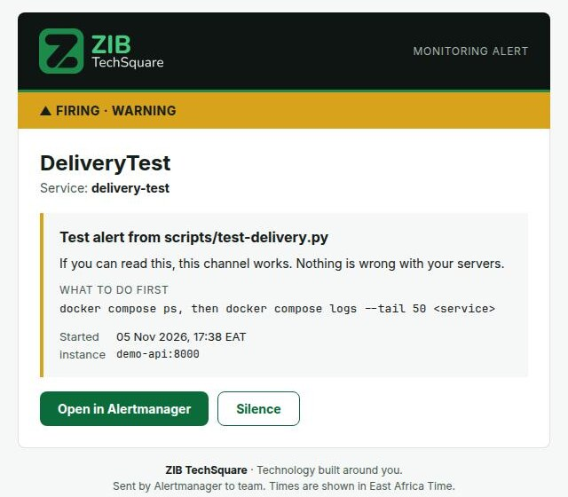
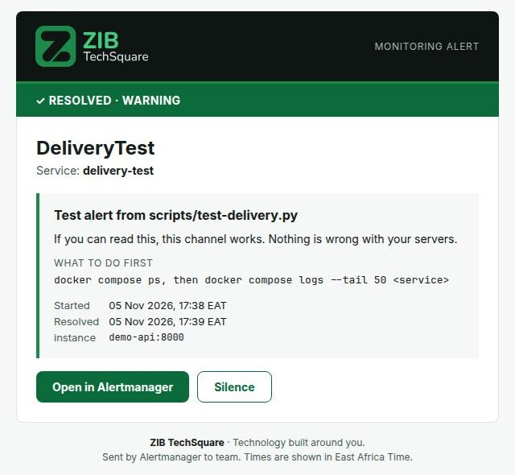

# monitoring-stack-starter

[](https://github.com/bashirii/monitoring-stack-starter/actions/workflows/check.yml)

A small, complete monitoring and alerting stack for Docker servers, with a demo service you can break on purpose. You run one command, and you get dashboards, alerts that reach an inbox, and a way to prove the alerts work.

It answers four questions about a server:

1. **Is it up?** Every target is scraped every 15 seconds, and an HTTP check asks the service from outside.
2. **Is it working?** Request rate, error ratio and latency per route.
3. **Is the machine healthy?** CPU, memory, disk and every container.
4. **Will someone find out?** Alerts go to email and Slack, and a `Watchdog` alert tells you when alerting itself has broken.

Everything here was written for this repository and run end to end. The alert rules have unit tests, and the alerts were fired for real (see [What was tested](#what-was-tested)).

## What is inside

| Part | What it does |
|------|--------------|
| **Prometheus** | Collects the numbers, stores them for 15 days, evaluates the alert rules |
| **Alertmanager** | Groups alerts, routes them, sends email, and keeps a service that is down from also paging for its errors |
| **Grafana** | Two dashboards, written as code: *Service overview* and *Host and containers* |
| **node-exporter** | Machine metrics: CPU, memory, disk, network |
| **cAdvisor** | Container metrics: CPU, memory, restarts, out-of-memory kills |
| **redis_exporter**, **postgres_exporter** | Health of the two databases the demo runs with |
| **Blackbox exporter** | Asks the service from outside: does `/health` answer, how fast |
| **demo-api** | A tiny FastAPI service with routes that fail or run slowly on purpose |
| **Mailpit** | Catches the alert emails so you can read them without a mail server |

## Quick start

You need Docker with Compose, and `openssl`. About 3 GB of images are pulled the first time.

```bash
git clone https://github.com/bashirii/monitoring-stack-starter.git
cd monitoring-stack-starter
cp .env.example .env            # optional: change ports
./scripts/secrets.sh            # creates random passwords in ./secrets and prints the Grafana login once
docker compose up -d --build
```

Then open (all on this machine only):

| Page | Address |
|------|---------|
| Grafana | <http://127.0.0.1:3000> (user `admin`, the password printed by `secrets.sh`) |
| Prometheus | <http://127.0.0.1:9090> |
| Alertmanager | <http://127.0.0.1:9093> |
| Alert emails (Mailpit) | <http://127.0.0.1:8025> |
| The demo service | <http://127.0.0.1:8000> |

Give it a minute: Grafana opens on *Service overview*. Send some traffic so the panels move:

```bash
python3 scripts/load.py ok 60
```

## See the alerts work

Break something and watch.

```bash
docker compose stop redis                 # RedisDown fires after about a minute, an email arrives
docker compose start redis                # it resolves, a second email arrives
python3 scripts/load.py errors 240        # half of the requests fail: HighErrorRate
python3 scripts/load.py slow 300          # every request takes 0.8 s: HighLatencyP95
docker compose stop demo-api              # TargetDown and ProbeFailed
```

`python3 scripts/test-alerts.py` does all of this for you, in order, and checks that each alert fired and each email arrived. It takes about 15 minutes, because alerts wait out their `for:` time before they fire.

## The alerts

| Alert | Fires when | Severity | First move |
|-------|-----------|----------|------------|
| `Watchdog` | Always. Goes to no one. Send it to a heartbeat service in production: when the heartbeat stops, alerting is broken | none | |
| `TargetDown` | A scrape target has not answered for 1 minute | critical | `docker compose ps`, then the container's logs |
| `ProbeFailed` | The outside HTTP check has failed for 1 minute | critical | Is the service up? Is a proxy or firewall in the way? |
| `RedisDown`, `PostgresDown` | The exporter reaches no database for 30 seconds | critical | The database container, its logs, its disk |
| `HighErrorRate` | More than 5% of requests return 5xx, over 5 minutes, for 1 minute | critical | The service's logs for the failing route |
| `HighLatencyP95` | 95% of requests take over 0.5 s, for 2 minutes | warning | Slow query, slow dependency, or too little CPU |
| `HostHighCpu` / `HostHighMemory` | CPU above 85% for 10 minutes, memory above 90% for 5 | warning | Which container? Look at *Host and containers* |
| `HostDiskAlmostFull` | Less than 15% free for 5 minutes | warning | Logs, images, old backups |
| `HostDiskFillsIn24h` | At the rate of the last 6 hours the disk is full within a day | warning | The same, before it becomes an outage |
| `ContainerKilledForMemory` | The kernel killed a container for memory | critical | Raise its memory limit, or fix the leak |
| `CertificateExpiresSoon` | An https target's certificate ends in under 14 days | warning | Renew it. Needs an https target in the blackbox job |

The thresholds are starting points. Change them in `prometheus/rules/alerts.yml`, run `./scripts/check.sh`, and reload Prometheus with a signal (the web reload and shutdown endpoints are left switched off on purpose, because they have no login):

```bash
docker compose kill -s HUP prometheus
```

## Use it for your own services

1. **Make the service expose metrics.** Any Prometheus client library will do. `demo-api/app.py` shows the two metrics that matter most for a web service: a request counter and a duration histogram, labelled by route and status.
2. **Add it to `prometheus/prometheus.yml`** as a new job, on the same Docker network.
3. **Add an outside check** by adding its address to the `blackbox-http` targets.
4. **Reuse the dashboards.** The queries in `scripts/build-dashboards.py` use `job="demo-api"`: change the job name, run the script, and commit the JSON.
5. **Run `./scripts/check.sh`.** It validates the configuration and runs the rule unit tests, with nothing started. The same script runs on every push in GitHub Actions.

## Real email, Slack and the Watchdog

By default every alert is also written to Mailpit, so you can read it without any account. To receive alerts for real, put the settings in `.env` (the names are in `.env.example`) and generate the Alertmanager settings from them:

```bash
python3 scripts/alerting.py            # writes the secret files and a local copy of the Alertmanager config
docker compose up -d alertmanager      # restart it with the new settings
python3 scripts/test-delivery.py       # sends one test alert and checks every channel
```

- **Email:** any SMTP server. For Gmail use `smtp.gmail.com`, port `587` and an [app password](https://myaccount.google.com/apppasswords) (needs 2-step verification), not your normal password. Alertmanager only sends over an encrypted connection.
- **Slack:** create an incoming webhook for a channel and put its URL in `SLACK_WEBHOOK_URL`.
- **Where the secrets go:** Alertmanager cannot read environment variables, so `alerting.py` writes the SMTP password and the webhook URL to `./secrets` (ignored by git) and the configuration only holds the path of each file. The generated `alertmanager/alertmanager.local.yml` and `compose.override.yaml` are also ignored by git. Delete both to go back to Mailpit only.
- **What the test shows:** `test-delivery.py` reads the counters Alertmanager keeps for each channel. A counter that goes up with no failure means the mail server or Slack accepted the message. It cannot see your inbox or channel, so it tells you what to look for there.
- **The look:** emails and Slack messages are written in `alertmanager/templates/zib.tmpl`. The email is plain HTML in tables with inline styles (so mail apps show it), has a plain-text twin, follows the system's light or dark mode where the mail app allows it, and shows the status as a word and a symbol as well as a colour. The Slack message has a coloured bar, a title that opens the alert, the summary and description, what to do first, the labels, four fields (severity, service, started, status) and a footer. The name, tagline, logo and time zone are the first lines of that file; change them to re-brand every message.
- **Links:** the buttons and the Source links open Alertmanager and Prometheus at `http://127.0.0.1:<port>` by default. Behind a domain, set `ALERTMANAGER_EXTERNAL_URL` and `PROMETHEUS_EXTERNAL_URL` in `.env`.
- **The logo in the email** is loaded from this repository on GitHub (`alertmanager/brand/`). If the repository is private, or the image is blocked, the mail app shows the name as text instead.
- **Watchdog:** it fires all the time, so it is routed to a "blackhole" receiver. In production, point it at a heartbeat service (for example healthchecks.io) that alerts you when the heartbeats stop.

## Security notes

- Every published port is bound to `127.0.0.1`. To reach Grafana from another machine, put a reverse proxy with HTTPS and a login in front of it. Do not publish Prometheus, Alertmanager or Mailpit to the internet: they have no login.
- Prometheus runs without its web reload and shutdown endpoints (`--web.enable-lifecycle` is off), so a web page you visit cannot stop it or reload it by sending a request to `127.0.0.1:9090`. Reload with `docker compose kill -s HUP prometheus`.
- Alertmanager and Mailpit have web pages and an API with no login. They are bound to `127.0.0.1` and hold only demo data here. Before you bind them to another address, add an authenticating reverse proxy, or give Alertmanager a `--web.config.file` with `basic_auth_users`, and stop publishing Mailpit's port (remove the service when you use a real mail server).
- Browsers can reach `127.0.0.1` from any web page you open. That is the reason for the three points above; keep the stack off a machine you use to browse untrusted sites if the data in it matters.
- The passwords are random files in `./secrets` (ignored by git). The compose file reads them as Docker secrets. Your SMTP password and Slack webhook URL live in `.env` and in files in `./secrets`, never in a committed file; a Slack webhook URL lets anyone post to your channel, so if it leaks, revoke it in Slack.
- `node-exporter` and `cAdvisor` read the host's filesystem read-only. That is how they see the machine, and it is why they should not be exposed.
- The demo service runs as a non-root user with a read-only filesystem and no extra capabilities.

## What was tested

Run on 2026-11-03 on Arch Linux with Docker 29.9.2 and Compose 5.6.1.

| Component | Version |
|-----------|---------|
| Prometheus | 3.15.1 |
| Alertmanager | 0.34.2 |
| Grafana OSS | 13.0.2 |
| node_exporter | 1.12.1 |
| cAdvisor | 0.60.6 |
| redis_exporter | 1.96.0 |
| postgres_exporter | 0.20.1 |
| Blackbox exporter | 0.29.1 |
| Mailpit | 1.33.0 |
| Redis / PostgreSQL | 7 / 17 |

**Static checks** (`./scripts/check.sh`, nothing started): the Prometheus, Alertmanager and Blackbox configuration are valid, the nine rule unit tests pass, the dashboards are valid JSON, and the compose file parses. To make sure the tests can fail, two rules were broken on purpose in a scratch copy (the error-rate threshold raised to 90%, the `TargetDown` expression changed): the tests failed both times.

**The stack running:** all 9 scrape targets were up within about a minute of `docker compose up`, and no rule had an evaluation error. `scripts/check-dashboards.py` ran every query of both dashboards through Grafana: 28 panels and 34 queries, no errors, and every panel showed data once traffic was sent.

**The alerts, fired for real** (`scripts/test-alerts.py`, 13 of 13 checks passed on 2026-11-03, about 15 minutes in all):

| Step | What was done | Alert fired after | Email |
|------|---------------|-------------------|-------|
| 1 | Redis stopped, then started | `RedisDown` 60 s | `[FIRING]` after 10 s, `[RESOLVED]` 25 s after the alert cleared |
| 2 | Half of the requests fail for 4 minutes | `HighErrorRate` 90 s | `[FIRING]` after 10 s |
| 3 | Every request takes 0.8 s for 5 minutes | `HighLatencyP95` 210 s | `[FIRING]` after 10 s |
| 4 | The demo service stopped, then started | `TargetDown` 80 s, `ProbeFailed` firing in the same window | `[FIRING]` after 10 s; `TargetDown` cleared 15 s after the restart |

Times include the rule's own `for:` wait and up to one 15-second scrape. The emails were read in Mailpit.

**The same test with Gmail and Slack switched on** (2026-11-05, 15 of 15 checks, the two new ones being the channel counters): every alert fired and every `[FIRING]` and `[RESOLVED]` email reached Mailpit again, and Alertmanager's counters showed 7 messages accepted by Slack and 14 emails (7 to Mailpit, 7 to Gmail), with no failed notification. The firing times were within 15 seconds of the first run (`RedisDown` 45 s, `HighErrorRate` 90 s, `HighLatencyP95` 225 s, `TargetDown` 75 s).

**Delivery to a real mail server and Slack** (`scripts/test-delivery.py`, 2026-11-05): one test alert sent straight to Alertmanager with Gmail's SMTP server (port 587, app password) and a Slack incoming webhook configured. Alertmanager's counters showed the firing message accepted by Mailpit, Gmail and Slack after 12 s, and the resolved message accepted by all three within a minute of the alert ending, with no failed notification. The generated configuration passes `amtool check-config` in `./scripts/check.sh`.


*The Service overview dashboard while half of the requests fail: one alert firing, a 49% error ratio.*

 

*The firing and the resolved email for a test alert (`scripts/test-delivery.py`), shown as Mailpit serves them. The layout is in `alertmanager/templates/zib.tmpl`.*

**Not tested yet:**

- The email layout in Outlook, Apple Mail and the phone mail apps, and in Gmail's dark mode.
- A Slack message that groups several alerts.
- An SMTP provider other than Gmail.
- The `CertificateExpiresSoon` alert (it needs an https target; only the rule syntax is checked).
- The host alerts on a live machine: CPU, memory, disk and out-of-memory are covered by unit tests but were not provoked for real.
- Routing `Watchdog` to a heartbeat service.
- Running on a remote server behind a reverse proxy, with `ALERTMANAGER_EXTERNAL_URL` and `PROMETHEUS_EXTERNAL_URL` set.
- Other operating systems, and upgrades between versions.

**Known limits:** cAdvisor lists every container on the host, not only this stack's, so the container panels show all of them. `HostDiskFillsIn24h` stays quiet for the first 6 hours of a new stack by design. The demo service's port is published only so you can send it traffic.

## Layout

```text
compose.yaml                 the whole stack
.env.example                 ports, retention, SMTP and Slack settings
prometheus/                  scrape jobs, alert rules, recording rules
alertmanager/                routing, inhibition, message templates (email, Slack), brand images
blackbox/                    the outside HTTP check
grafana/                     datasource and dashboards, provisioned as code
demo-api/                    the service that gets monitored
tests/rules_test.yml         unit tests for the alert rules
scripts/                     secrets, alert delivery setup and test, static checks, load, alert test, dashboard check, dashboard generator
.github/workflows/check.yml  runs the static checks and rule unit tests on every push
```

## Licence

MIT, see `LICENSE`.
